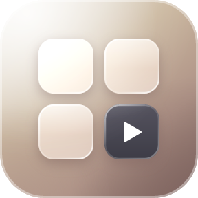
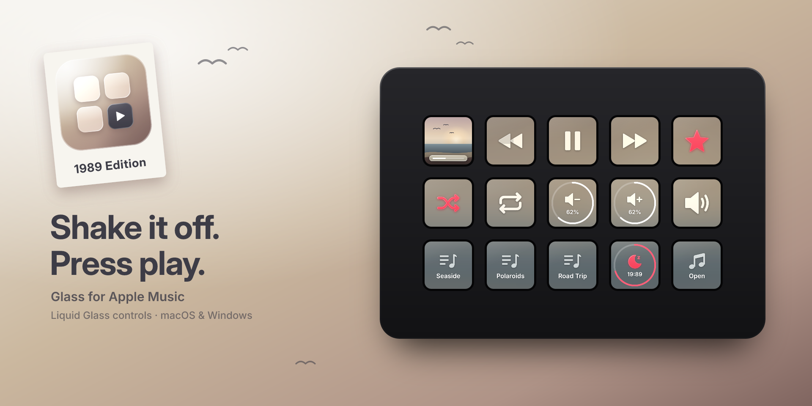
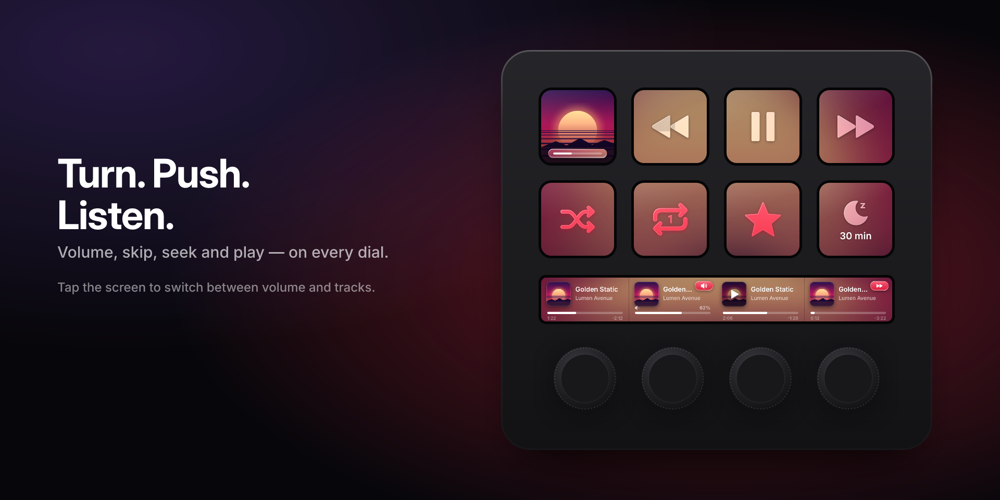
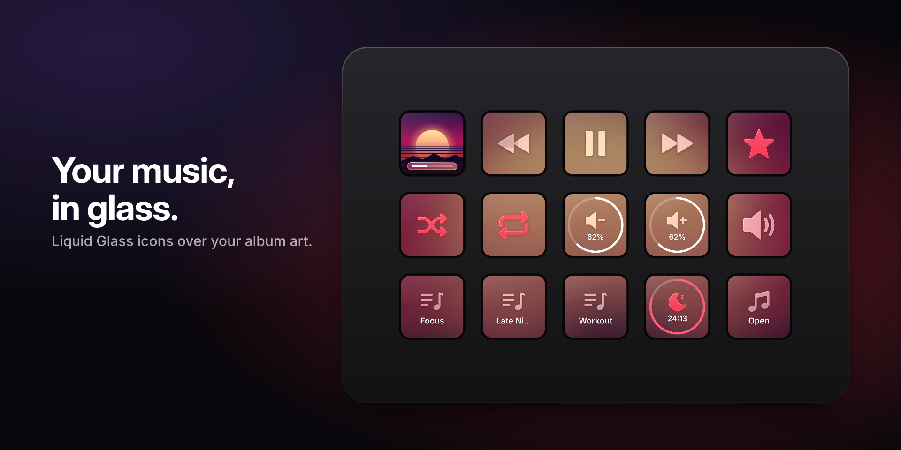
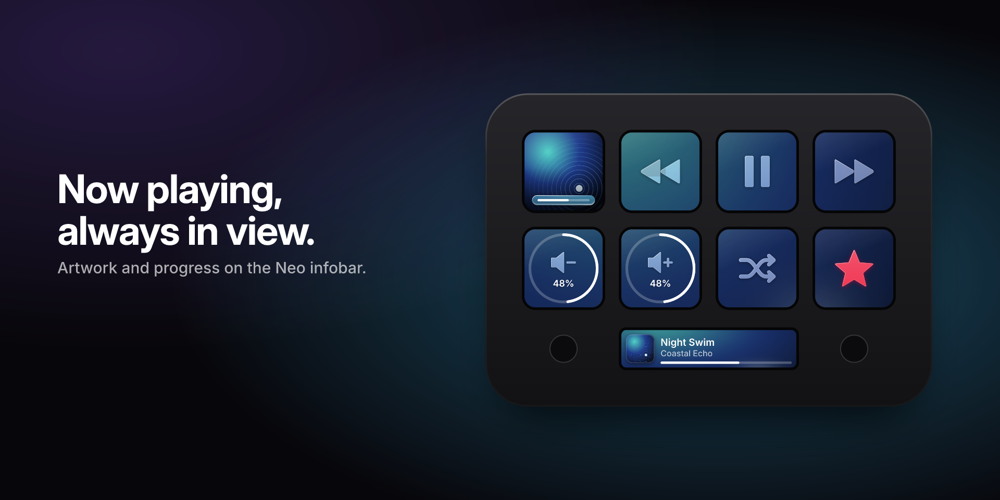
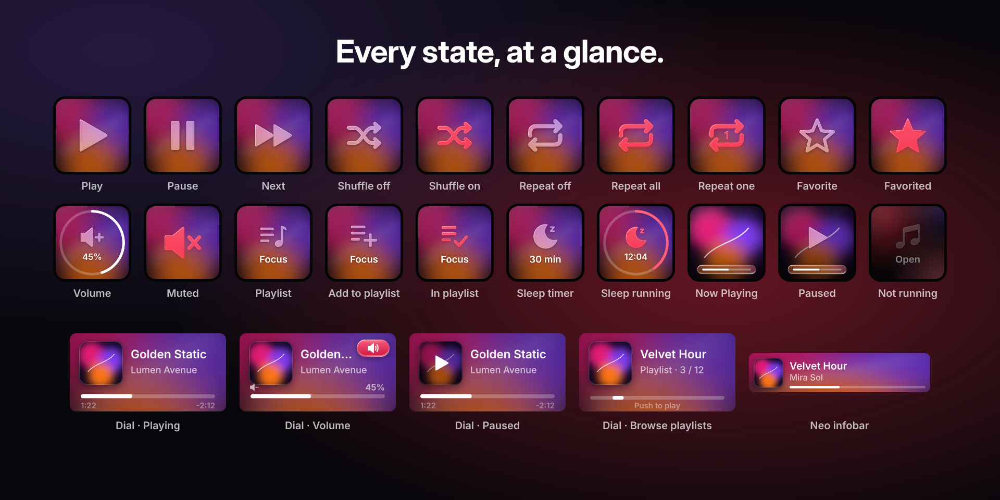

  

<h1 align="center">Glass for Apple Music</h1>

  Control Apple Music from your Elgato Stream Deck — with Liquid Glass keys that take on the colors of the album you're playing. 
  <b>macOS · Windows · Stream Deck, Stream Deck + and Stream Deck Neo</b>

  

> **Coming soon to the [Elgato Marketplace](https://marketplace.elgato.com/stream-deck/plugins).** The Marketplace is the only official place to get the plugin. This repository is for news, screenshots, bug reports and ideas; the source code is not public.

## Features

- **Liquid Glass keys** — every icon is a piece of glass lying on the blurred artwork of the album that's playing. The artwork is spread across your whole deck, so a full Stream Deck reads as one continuous image. When a new album starts, the backdrop fades into its colours while the keys switch instantly.
- **Playback** — play/pause, next, previous, shuffle and repeat, with the real state on every key.
- **Now Playing** — album artwork with live progress on a key, the Stream Deck + touch strip or the Stream Deck Neo infobar.
- **Volume** — up, down, mute or jump to a level; hold to keep adjusting. Controls Apple Music only, not your system volume.
- **Playlists** — start a playlist with one key, browse all your playlists with a dial, or add the playing song to a playlist (the key lights up when the song is already in it).
- **Favorite** — favorite the playing song.
- **Sleep timer** — pause Apple Music after 5 minutes to 2 hours; extend, restart or stop it from the same key.
- **Stream Deck + dials**
  - **Multimedia** — turn for volume or tracks, push to play/pause, push and turn to seek, tap to switch modes, hold to mute.
  - **Scrub** — turn to move through the song (slowly for single seconds, spin to cross the whole song), tap the timeline to jump there, hold to restart, push to play/pause.
  - **Browse Songs** (macOS) — scroll through the songs of the playlist that's playing and push to play the one you pick.
  - **Browse Playlists** — scroll through your playlists and push to play one.
- **8 languages** — English, German, French, Spanish, Japanese, Korean, Simplified and Traditional Chinese.

  

## Platform support

| Feature | macOS | Windows |
|---|---|---|
| Play/pause, next, previous | ✅ | ✅ |
| Shuffle, repeat | ✅ | 🧪 |
| Now Playing (keys, touch strip, Neo infobar) | ✅ | ✅ |
| Volume and mute | ✅ | ✅ |
| Sleep timer, Multimedia dial | ✅ | ✅ |
| Favorite | ✅ | 🧪 |
| Scrub dial | ✅ | 🧪 |
| Play Playlist, Browse Playlists | ✅ | 🧪 |
| Browse Songs dial | ✅ | — |
| Add to Playlist | ✅ | — |

🧪 = experimental. Apple Music for Windows offers far fewer ways for other apps to control it than the Mac version, so these features depend on the app's user interface and may break when Apple updates it.

## Requirements

- Stream Deck app **7.6** or later
- **macOS 14** or later with the Music app, or **Windows 10/11** with [Apple Music from the Microsoft Store](https://apps.microsoft.com/detail/9pfhdd62mxs1)
- Any Stream Deck; dial actions need a Stream Deck +, the infobar action a Stream Deck Neo

On macOS, the first time you use the plugin, macOS asks whether **Stream Deck may control Music**. Choose **OK**; you can change this later in System Settings → Privacy & Security → Automation.

## Screenshots

| | |
|---|---|
|  |  |

## Reporting a bug or suggesting an idea

Use **[Issues → New issue](https://github.com/alexhensen/Glass/issues/new/choose)** and pick *Bug report* or *Feature request*. For bugs, please include:

- your platform and versions (macOS/Windows, Stream Deck app, Apple Music, plugin)
- your Stream Deck model
- the plugin log:
  - macOS: `~/Library/Application Support/com.elgato.StreamDeck/Plugins/com.alexhensen.applemusic.sdPlugin/logs/`
  - Windows: `%APPDATA%\Elgato\StreamDeck\Plugins\com.alexhensen.applemusic.sdPlugin\logs\`

Please don't post personal information in logs or screenshots.

## Privacy

The plugin collects no data and has no accounts or analytics. It talks to Apple Music on your computer. When a song has no artwork available locally, it looks the artwork up via Apple's public iTunes Search API by sending the artist and album or song title; nothing else leaves your computer.

## Legal

Apple, Apple Music and iTunes are trademarks of Apple Inc. Stream Deck and Elgato are trademarks of Corsair Memory, Inc. Glass for Apple Music is an independent project and is not affiliated with, endorsed by or sponsored by Apple or Elgato.

© 2026 Alex Hensen. All rights reserved. The screenshots and text in this repository may not be reused without permission.
